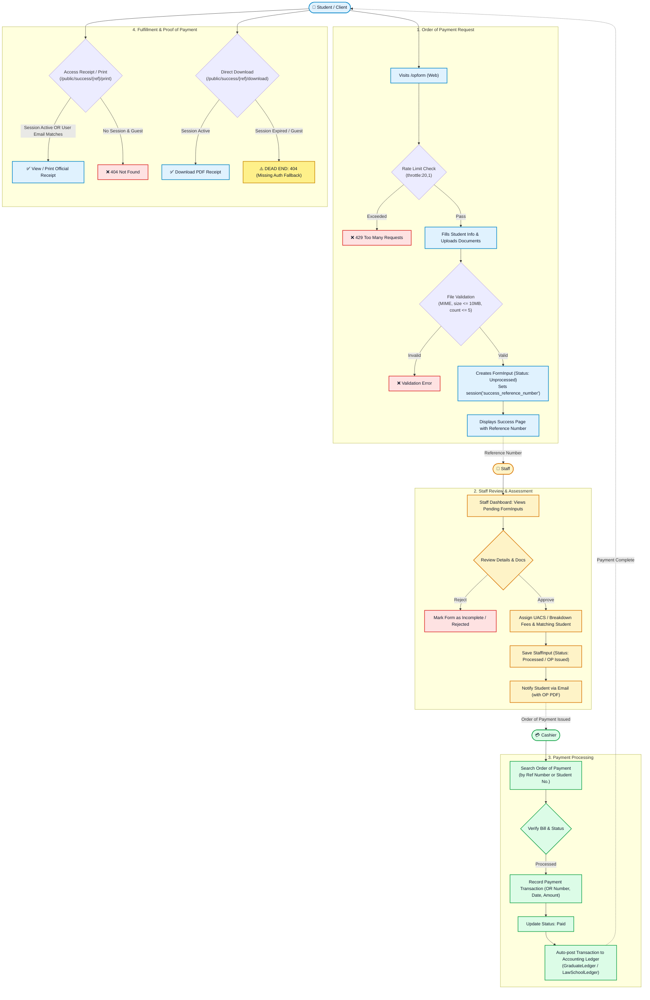
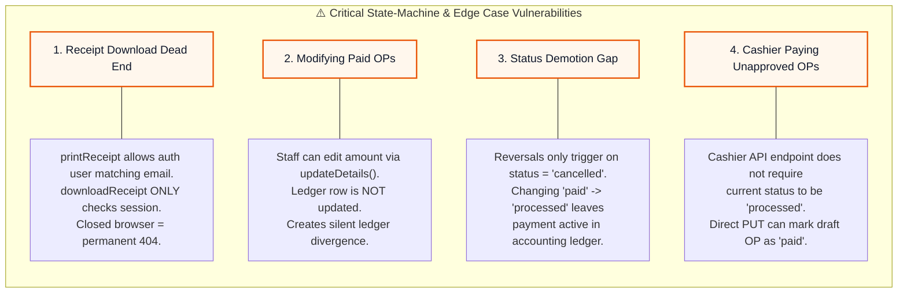

# Core System Workflow & Edge Cases Flowchart

This document outlines the end-to-end lifecycle of an Order of Payment (OP), from student submission through staff assessment, cashier payment, and receipt fulfillment—including edge cases, dead ends, and state-machine vulnerabilities.

---

## 1. End-to-End Workflow Diagram

---

## 2. Identified Edge Cases & Vulnerabilities

---

## 3. Summary of Workflow Steps

| Phase | Actor | Endpoint | Main Action | Key Validations & Guards |
| :--- | :--- | :--- | :--- | :--- |
| **1. Submission** | Student / Client | `POST /opform` | Submits payer details & documents | `throttle:20,1`, MIME verification, max 10MB, max 5 files |
| **2. Review** | Staff | `POST /staff/requests/process` | Validates details & assigns fees | Prevents duplicate processing, links student term |
| **3. Payment** | Cashier | `PUT /cashier/requests/{id}/payment` | Inputs OR number and marks paid | Validates `or_no` & `or_date`, posts to student ledger |
| **4. Fulfillment** | Student / Client | `GET /public/success/{ref}/print` | Prints / views official proof | Session check or authenticated matching email check |
